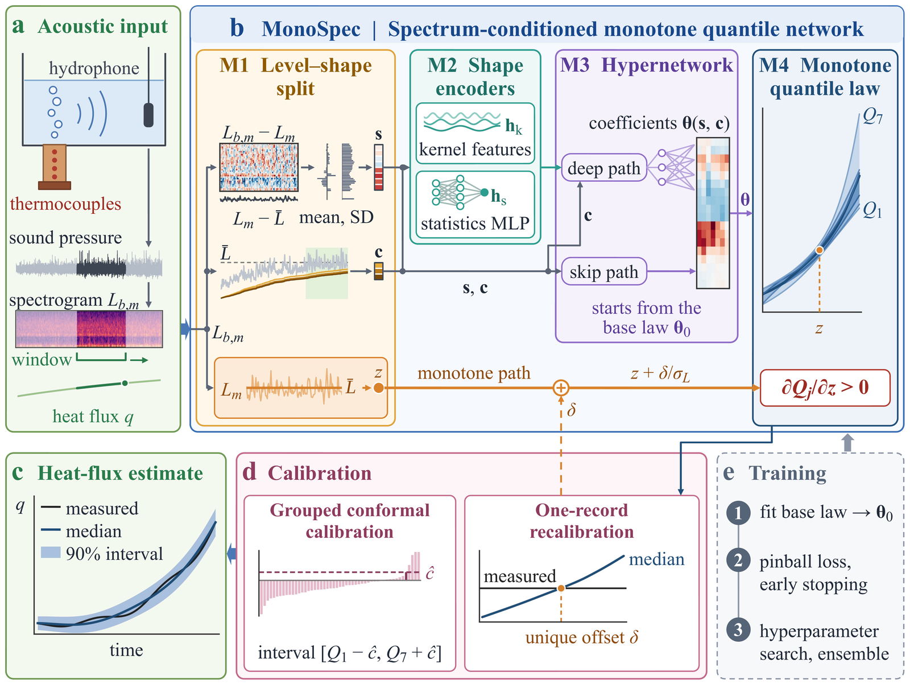
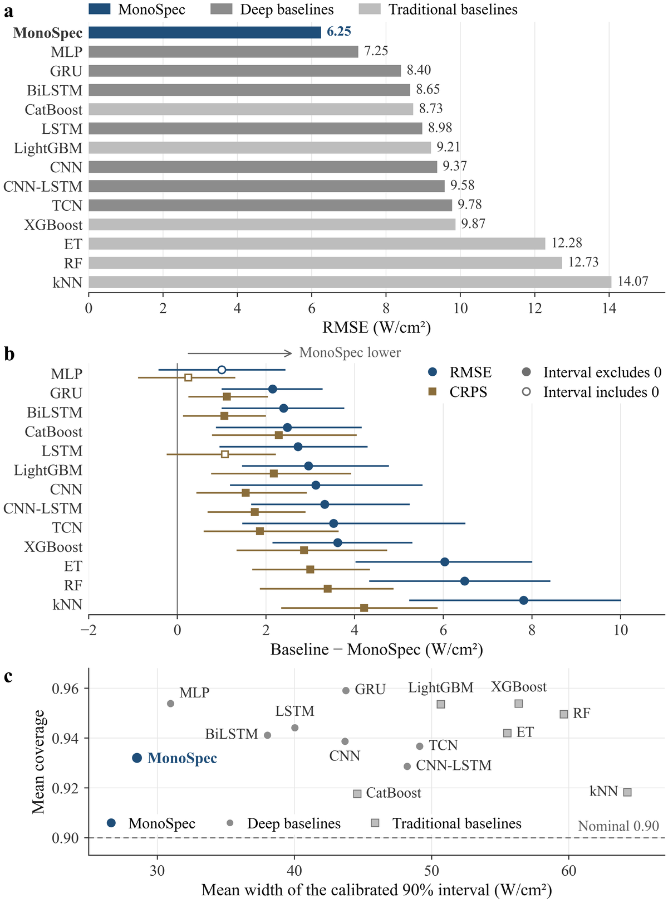
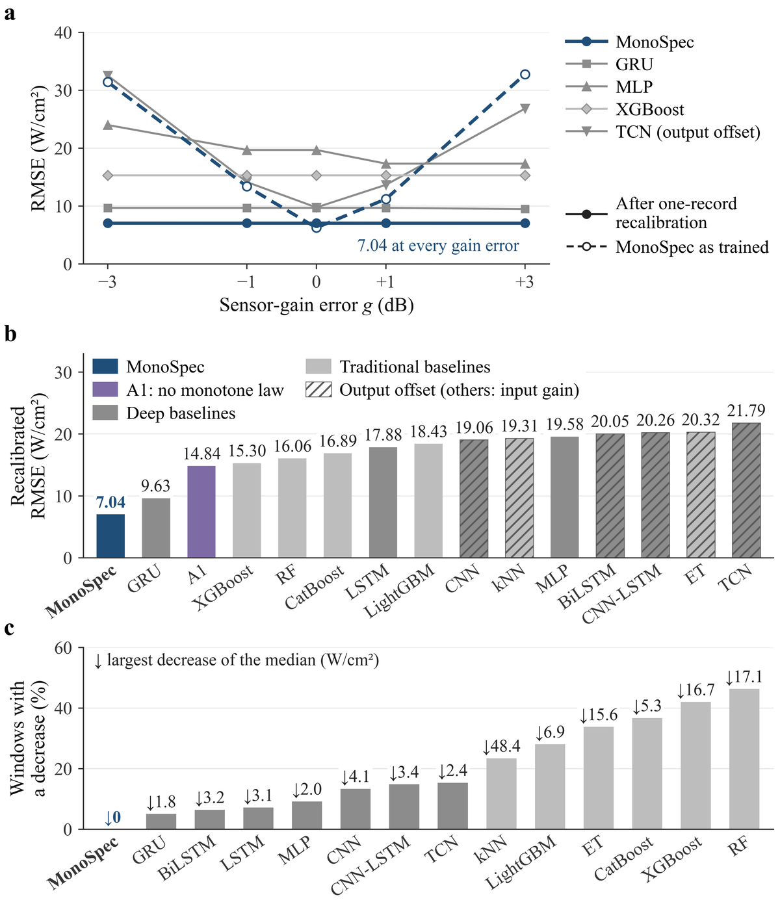
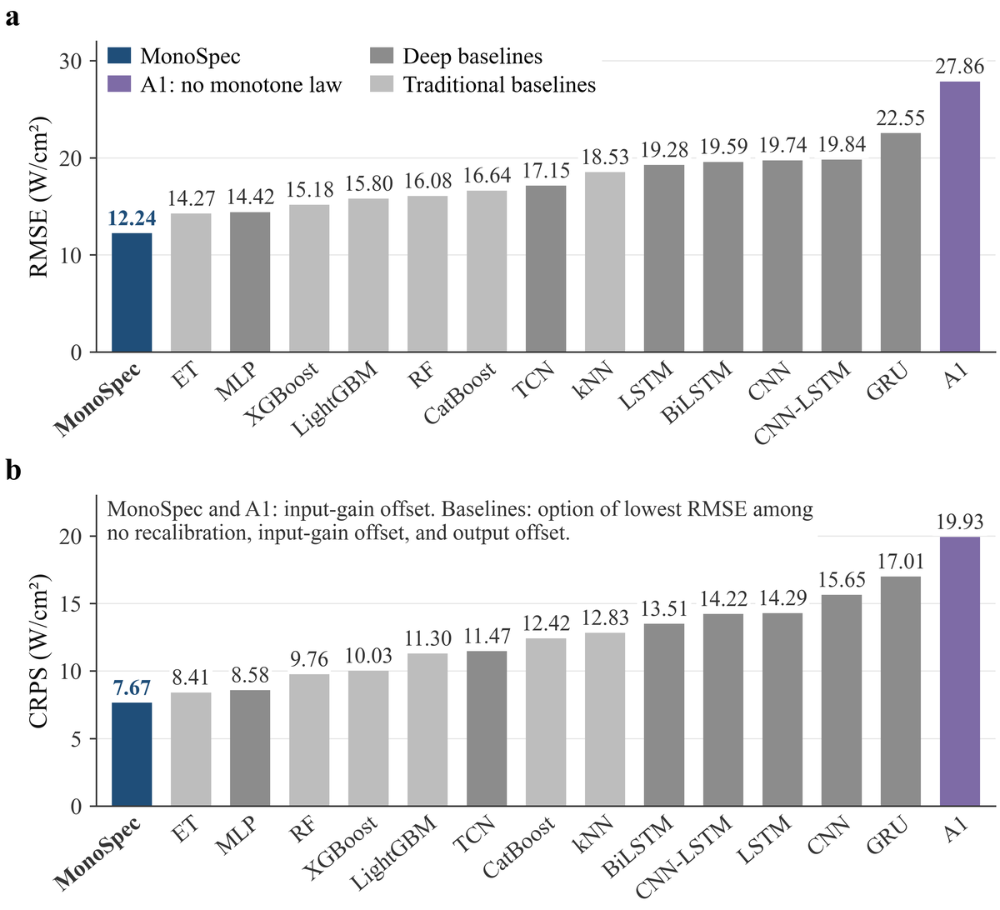

# MonoSpec

**Spectrum-conditioned monotone quantile network for non-invasive acoustic monitoring of boiling heat flux with one-record recalibration**

## Overview

The critical heat flux (CHF) bounds the safe operation of boiling-cooled energy systems, from electronics and batteries to nuclear reactors. MonoSpec estimates the heat flux of a boiling surface from the signal of a single hydrophone, returns calibrated 90% prediction intervals, and is recalibrated from one low-heat-flux record after a change of sensor gain or on a new heating surface.

A hypernetwork reads the level-free spectral shape of the hydrophone signal and sets the coefficients of a quantile law that is strictly increasing in the sound level. The sensor gain therefore reaches every output through one monotone path, so a single record of known heat flux identifies a gain offset uniquely. Grouped conformal calibration adds the 90% prediction intervals.

MonoSpec is evaluated under two protocols:

- **Protocol 1:** unseen experiments of the five heating surfaces.
- **Protocol 2:** held-out surfaces, each tested with an ensemble that never saw the surface.



## Highlights

- **Level–shape split.** The window level carries the sensor gain; the spectral shape, free of the level, identifies the boiling state and still tracks the heat flux where the level saturates near CHF.
- **Monotone quantile law.** Seven quantiles are strictly increasing in the window level by construction, with linear tails, and a hypernetwork sets all coefficients from the spectral shape and the slow level context.
- **One-record recalibration.** The monotone response gives the recalibration equation exactly one root, found by bisection to 0.01 dB from a single low-heat-flux record, with no retraining.
- **Calibrated uncertainty.** Grouped conformal calibration turns the quantiles into 90% prediction intervals.
- **Light and single-sensor.** One hydrophone is enough, the ensemble members of Protocol 1 have 0.05–0.79 million parameters, and inference runs on a CPU.

## Key Results

On the public pool-boiling dataset of Pandey and Hu (65 experiments, five heating surfaces), MonoSpec was compared with 13 deep and traditional machine-learning baselines. The figures show the baselines and the ablation A1 of the paper; `scripts/test.py` reproduces the MonoSpec results of Sections 3.1, 3.2, and 3.4 of the paper.

**Unseen experiments of seen surfaces (Protocol 1).** RMSE of 6.25 W/cm², 14–56% below the baselines, with the narrowest calibrated 90% intervals at a coverage of 0.93.



**Sensor-gain errors (Protocol 1).** After one-record recalibration, the RMSE stays at 7.04 W/cm² for gain errors of ±1 and ±3 dB, 27% below the best baseline.



*A1 is MonoSpec without the monotone law; hatched bars use an output offset, all other models an input-gain offset; the dashed line is MonoSpec without recalibration.*

**Unseen heating surfaces (Protocol 2).** One low-heat-flux record transfers the model to a held-out surface at 12.24 W/cm², 14% below the best baseline.



*A1 is MonoSpec without the monotone law; each baseline is shown at its option of lowest RMSE.*

## Repository Structure

```
data/      data description, feature format, and a 6 MB sample
scripts/   train.py (feature preparation and training), test.py (evaluation and inference)
models/    final MonoSpec weights and configuration (Protocol 1 and Protocol 2)
assets/    figures of this README
```

## Usage

Requirements: Python 3.10+, `numpy`, `scipy`, `torch`; `pandas` for `prepare` and `optuna` for the search.

### Training

```bash
python scripts/train.py prepare --raw <folder with the Dataverse files> --out data/features.npz
python scripts/train.py
```

`prepare` builds the feature file once from the hydrophone and thermocouple files (28 GB of the 65 GB dataset). `train.py` runs the search and the final ensembles of both protocols in about 30 minutes on one NVIDIA RTX 6000 Ada GPU and overwrites `models/`; use `--models DIR` to keep the released weights, and `--protocol`, `--folds`, `--trials`, and `--no-search` to run parts of it.

### Testing

```bash
python scripts/test.py --data data/sample.npz
python scripts/test.py
```

The first command evaluates the released models on a sample excerpt in seconds on a GPU and in about a minute on a multi-core CPU; its metrics refer to the excerpt. The second reproduces the MonoSpec results of the paper on the full feature file `data/features.npz`, which `train.py prepare` builds (see Training): accuracy and calibrated intervals on unseen experiments (Protocol 1), gain errors with one-record recalibration, and held-out surfaces (Protocol 2).

To estimate the heat flux of a new recording:

```bash
python scripts/test.py predict --input recording.wav --calibration recalibration.wav --calibration-heat-flux 11.3 --chf-ref 183.87
```

The recording is a WAV file, a CSV of samples, or a log-mel CSV at 1024 Hz or more, in the units of the dataset's hydrophone channel. A recalibration record of known mean heat flux (`--calibration`, `--calibration-heat-flux`) gives the gain offset. `prediction_results.csv` has one row per window with the seven quantiles, the median, the 90% interval, the window level, a `status` flag, and, with `--chf-ref`, the ratio to the CHF and a risk level. `--fold`, `--protocol`, and `--step` select the ensembles and the window spacing; see `--help`.

## Data Availability

The experiments are the public pool-boiling dataset of Pandey and Hu (CC0 1.0, [doi:10.7910/DVN/6GLGC6](https://doi.org/10.7910/DVN/6GLGC6)), described in H. Pandey, C. Li, H. Hu, Data in Brief 55 (2024) 110582. `data/README.md` describes the feature file and how to build it from the raw files.

## Citation

The citation will be added after publication.
